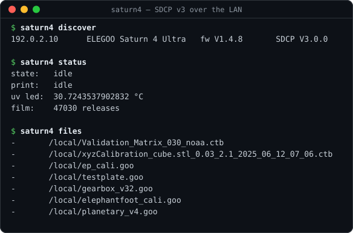

# saturn4-bridge

Zero-dependency LAN client for the **ELEGOO Saturn 4 Ultra** resin printer, speaking SDCP v3. It replaces
ChituManager / ELEGOO Satellite for file transfer and print control: no cloud, no account, no proprietary bits.
It can also convert PrusaSlicer `.sl1` exports to the printer's `.ctb`/`.goo` formats via UVtools, applying an
elephant-foot compensation and an area-proportional wait-before-cure on the way.

## Requirements

- **[Bun](https://bun.sh)** (the script uses Bun's built-in `WebSocket`, `fetch` and `FormData`; no `npm install` needed).
- **[UVtools](https://github.com/sn4k3/UVtools)** with its `uvtoolscmd` CLI on `PATH` (or at `~/.local/bin/uvtoolscmd`),
  needed for `.sl1` conversion, erode and wait-time processing. Uploading ready-made `.goo`/`.ctb` files needs only Bun.
- Optional: `zenity` for the GUI front-end.
- The printer on the same LAN, with UDP 3000 and TCP 3030 reachable.

Developed on Fedora Linux against a Saturn 4 Ultra reporting SDCP `V3.0.0`.

## Install

    git clone https://github.com/Bulrok/saturn4-bridge-linux.git ~/src/saturn4-bridge-linux
    ln -s ~/src/saturn4-bridge-linux/saturn4.js ~/.local/bin/saturn4      # or: bun ~/src/saturn4-bridge-linux/saturn4.js ...

If `bun` is not on the `PATH` of non-login shells, use a small wrapper instead of the symlink:

    #!/bin/sh
    export PATH="$HOME/.bun/bin:$PATH"
    exec bun "$HOME/src/saturn4-bridge-linux/saturn4.js" "$@"

GUI (optional):

    install -m755 contrib/saturn4-send-gui ~/.local/bin/
    install -m644 contrib/saturn4-send.desktop ~/.local/share/applications/
    ln -s ~/.local/bin/saturn4-send-gui ~/.local/share/nautilus/scripts/"Send to Saturn 4 Ultra"   # Nautilus right-click > Scripts

## Usage

    saturn4 discover                     # find printers on the LAN
    saturn4 status                       # idle / printing, layer progress, UV LED temp
    saturn4 attrs                        # firmware, resolution, capabilities (JSON)
    saturn4 files [/local|/usb]          # list files on the printer
    saturn4 send  model.sl1 [--start]    # .sl1 → .ctb via UVtools, upload, optionally start
    saturn4 send  model.goo --start
    saturn4 upload model.ctb             # upload only
    saturn4 convert model.sl1            # conversion + erode + wait times, no upload
    saturn4 print name.goo               # start a file already on the printer
    saturn4 delete name.goo
    saturn4 pause | resume | stop

Options: `--ip=<printer-ip>`, `--format=ctb|goo` (for `.sl1` conversion; default `ctb`), `--layer=N` (start layer),
`--json`, `--debug`, `--timeout=ms` (discovery), `--erode=…`, `--no-erode`, `--no-autowait`.

The printer address is taken from `--ip`, then `$SATURN4_IP`, then `~/.config/saturn4/ip`, and finally from UDP
discovery, which caches the result in that file.

### Elephant-foot compensation

After conversion, the first layers are eroded with UVtools' Morph operation (chamfered), so a part printed directly
on the build plate does not flare out at the bottom. The default is `9:1:0-9`: erode 9 px tapering to 1 px over
layers 0–9 (ending at 1 px avoids a visible ledge at the last eroded layer). Override per call with
`--erode=START:END:FIRST-LAST`, or permanently by writing a spec to `~/.config/saturn4/erode` (`off` disables it).
`--no-erode` skips it, e.g. for parts on supports. Calibrate for your own resin and exposure.

### Wait before cure, proportional to layer area

Large layers need more time for the resin to settle after the tilt/lift. The per-layer wait is
area × seconds-per-1000 mm², clamped to [min, max] and limited in how much it can change per layer; the first
`bottomHeight` mm (bottom + transition layers) use the bottom curve. Defaults (generous, tuned for a fairly viscous
resin, ~800 cps):

| group  | s per 1000 mm² | min   | max  | max step |
|--------|----------------|-------|------|----------|
| bottom | 10             | 15 s  | 45 s | 5 s      |
| normal | 2              | 1.5 s | 8 s  | 1 s      |

"Mass" is the largest layer within 0.3 mm below the current one, and a blank first layer is inserted because the
firmware ignores the wait on layer 0. Per-layer settings can only be written by UVtools to **CTB**, which is why
`.ctb` (encrypted) is the default output; the printer accepts both. With `--format=goo` the two file-level waits are
instead sized from the largest layer in each group. `--no-autowait` skips all of this.

Override any of these in `~/.config/saturn4/wait.json`; `contrib/wait.example.json` lists every key with its default.

### GUI

`saturn4-send-gui [file]` (zenity) asks for a file if none is given. For `.sl1` files it asks *Erode (part on the
plate)* vs *No erode (part on supports)*, then *Upload only* vs *Upload and start print*, and shows upload progress.
Cancel does nothing.

## Slicing pipeline (all FOSS)

1. **PrusaSlicer**: printer profile *Elegoo Saturn 4 Ultra 12K* (from UVtools' PrusaSlicer profiles). Export → `.sl1`.
2. **UVtools**: converts `.sl1` → `.ctb`/`.goo`; also useful for island/overhang repair and calibration prints.
   `saturn4 send` runs the conversion for you.
3. **saturn4**: upload and start over the LAN.

Lift/retract/wait times for the tilting vat can live in the PrusaSlicer *printer* profile Notes
(`START_CUSTOM_VALUES … END_CUSTOM_VALUES`); material notes can carry keys such as `WaitTimeBeforeCure_3`,
`BottomWaitTimeBeforeCure_5`, `TransitionLayerCount_5`. UVtools applies them during conversion.

## Protocol

SDCP v3 as implemented by the Saturn 4 Ultra:

- **Discovery**: send the ASCII string `M99999` to UDP port 3000 (broadcast or unicast). The printer replies with JSON
  containing `Id` and, in `Data`, `MainboardID`, `MainboardIP`, `MachineName`, `BrandName`, `FirmwareVersion` and
  `ProtocolVersion`. Every later request must carry `Id` and `MainboardID`.
- **Control**: JSON over `ws://<ip>:3030/websocket`. Requests go to topic `sdcp/request/<MainboardID>` with
  `Data: { Cmd, Data, RequestID, MainboardID, TimeStamp, From: 0 }`; replies arrive on `sdcp/response/…` matched by
  `RequestID`, and status/attributes are pushed on `sdcp/status/…` / `sdcp/attributes/…`.
  Commands used: `0` status, `1` attributes, `128` start print (`Filename`, `StartLayer`), `129` pause, `130` stop,
  `131` resume, `258` list files (`Url`), `259` delete (`FileList`, `FolderList`).
- **Upload**: chunked (1 MiB) multipart POST to `http://<ip>:3030/uploadFile/upload` with fields `Uuid`, `Offset`,
  `TotalSize`, `Check=1`, `S-File-MD5` and `File`. The printer then verifies the file (status 2, "file
  transferring") and refuses a start until that finishes; `send --start` waits for it.

Reference: [SDCP v3.0.0 specification](https://github.com/cbd-3d/SDCP-Smart-Device-Control-Protocol-V3.0.0).

## Status and limitations

- In regular use with one Saturn 4 Ultra. Other SDCP v3 ELEGOO resin printers will probably work for discovery,
  status and upload, but are untested.
- SDCP v1/v2 printers are not supported (the tool checks for `V3`).
- The protocol has no authentication: anyone on the LAN can control the printer. Keep it on a trusted network.
- `uvtoolscmd convert` exits non-zero even on success, so success is judged by the output file instead.

## License

GPL-3.0-or-later. See [LICENSE](LICENSE).

Not affiliated with or endorsed by ELEGOO, Chitu Systems, or the UVtools or PrusaSlicer projects. All trademarks
belong to their respective owners.
